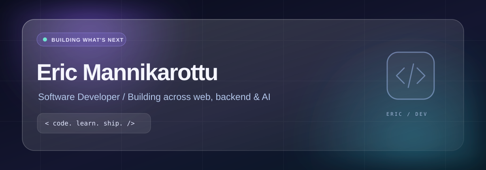

  

   

  
  

### About me

I'm **Eric**, a developer interested in creating useful, polished software — from responsive interfaces to backend services and applied AI experiments. I enjoy learning how systems work, building hands-on projects, and improving my engineering fundamentals.

- **Currently exploring:** backend engineering, full-stack development, and applied AI.
- **What matters to me:** clean interfaces, clear architecture, and practical problem-solving.
- **Open to:** opportunities to learn, collaborate, and build meaningful products.

### Toolbox

  

Technologies represented across my public repositories and current areas of learning; not a claim of expert-level proficiency in every tool.

### Selected work

<table>
  <tr>
    <td width="50%" valign="top">
      <h3><a href="https://github.com/EricMannikarottu/emotion-based-screening-and-hiring-system">AI-assisted interview prototype</a></h3>
      An experimental interview workflow combining facial-expression, voice, and answer-quality signals with an explainable review interface. <strong>Prototype only — not a validated or appropriate standalone hiring decision system.</strong>
    </td>
    <td width="50%" valign="top">
      <h3><a href="https://github.com/EricMannikarottu/jwt-auth-app">JWT Auth App</a></h3>
      A repository focused on learning and implementing token-based authentication concepts.
    </td>
  </tr>
  <tr>
    <td width="50%" valign="top">
      <h3><a href="https://github.com/EricMannikarottu/dennis-snellenberg-portfolio">Portfolio UI exploration</a></h3>
      Exploring modern frontend composition, interactions, and visual presentation using a portfolio template.
    </td>
    <td width="50%" valign="top">
      <h3><a href="https://github.com/EricMannikarottu/backend-basic-skeleton">Backend Basic Skeleton</a></h3>
      A small starter repository for understanding backend project structure and foundations.
    </td>
  </tr>
</table>

### Development snapshot

  <picture>
    <source media="(prefers-color-scheme: dark)" srcset="https://github-readme-stats.vercel.app/api/top-langs/?username=EricMannikarottu&layout=compact&hide_border=true&bg_color=0b1023&title_color=d6b4ff&text_color=c3cfe8&langs_count=6" />
    
  </picture>

Language statistics reflect public repository contents, not proficiency or time spent coding. External stats may be unavailable occasionally.

---

  Curious by default. Building with intention. Always improving.

